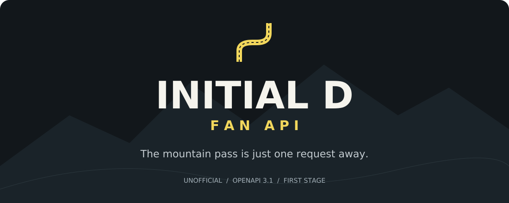
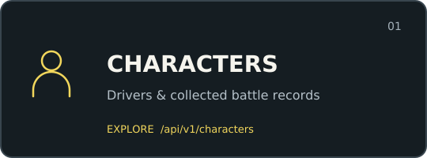
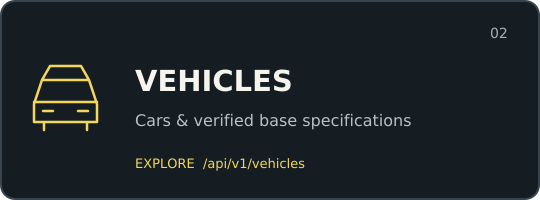
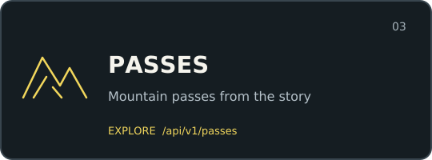
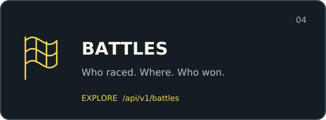

<p align="center">
  
</p>

<h1 align="center">Initial D Fan API</h1>
<p align="center"><strong>あのドライバー、あのマシン、あの峠。ひとつのリクエストで。</strong></p>
<p align="center">頭文字Dのキャラクター・車種・峠・バトルをつなぐ、読み取り専用REST API。</p>

<p align="center">
  <a href="https://initial-d-fan-api.saitoudayooooon-jo.com/docs"></a>
  <a href="https://github.com/honojs/hono"></a>
  <a href="#development"></a>
  <a href="LICENSE"></a>
</p>

<p align="center">
  <a href="https://initial-d-fan-api.saitoudayooooon-jo.com/docs"><strong>APIドキュメント ↗</strong></a>
  &nbsp; · &nbsp; <a href="#quick-start">今すぐ試す</a>
  &nbsp; · &nbsp; <a href="#endpoints">エンドポイント</a>
  &nbsp; · &nbsp; <a href="https://github.com/saitojo1106/initial-d-fan-api/issues/new/choose">提案・不具合報告</a>
</p>

<p align="center"><sub>非公式・非提携のファンプロジェクトです。権利者による公認・後援はありません。</sub></p>

<br>

<p align="center"><strong>拓海を調べる。秋名の対戦をたどる。結果はJSONで。</strong></p>
<p align="center"></p>

<br>

<a name="features"></a>
<h2></h2>

<p align="center">
  <a href="https://initial-d-fan-api.saitoudayooooon-jo.com/api/v1/characters"></a>
  <a href="https://initial-d-fan-api.saitoudayooooon-jo.com/api/v1/vehicles"></a>
  <br>
  <a href="https://initial-d-fan-api.saitoudayooooon-jo.com/api/v1/passes"></a>
  <a href="https://initial-d-fan-api.saitoudayooooon-jo.com/api/v1/battles"></a>
</p>
<p align="center"><sub>カードを押すと、それぞれの公開APIのJSONを表示します。</sub></p>

| データ | できること |
| --- | --- |
| **キャラクター** | 名前で検索し、車種と収録済みの対戦成績を確認 |
| **車種** | 実在するベース車両の確認済み仕様を参照 |
| **峠** | 作中の峠名から関連するバトルを探索 |
| **バトル** | 参加者・車種・峠・勝者を参照し、条件で絞り込み |

**First Stageから、まずは7つの主要なドライバー対戦を。** キャラクター7件・車種7件・峠名3件・出典14件を収録しています。戦績は収録済みの対戦だけの集計です。

<br>

<a name="quick-start"></a>
<h2></h2>

**最初のリクエストは、藤原拓海から。** `jq`を使うとJSONを整形して表示できます。

```sh
BASE_URL='https://initial-d-fan-api.saitoudayooooon-jo.com'
curl -s "$BASE_URL/api/v1/characters/takumi-fujiwara" | jq
```

`/api/v1/characters/takumi-fujiwara`のレスポンス例:

```json
{
  "data": {
    "id": "takumi-fujiwara",
    "name": "藤原拓海",
    "vehicleIds": ["toyota-ae86-trueno"],
    "sourceIds": ["yanmaga-battle-01", "yanmaga-battle-16"],
    "record": { "wins": 6, "losses": 0, "total": 6 }
  }
}
```

**秋名のバトルを探す。** 同じターミナルで続けて実行できます。

```sh
curl -s "$BASE_URL/api/v1/battles?passId=akina" | jq
```

[ブラウザーでAPIドキュメントを開く ↗](https://initial-d-fan-api.saitoudayooooon-jo.com/docs) · [OpenAPI JSON](https://initial-d-fan-api.saitoudayooooon-jo.com/openapi.json)

<br>

<a name="endpoints"></a>
<h2></h2>

| メソッド | パス | 内容 |
| --- | --- | --- |
| GET | `/api/v1/characters` | 一覧。`q`で名前またはIDを部分検索 |
| GET | `/api/v1/characters/{id}` | キャラクターと収録済みバトルだけから計算した戦績 |
| GET | `/api/v1/vehicles` | 車種一覧とベース車両の確認済み仕様 |
| GET | `/api/v1/vehicles/{id}` | 車種詳細 |
| GET | `/api/v1/passes` | 作中の峠名一覧。位置情報は含まない |
| GET | `/api/v1/passes/{id}` | 峠名詳細 |
| GET | `/api/v1/battles` | バトル一覧。`characterId`と`passId`で絞り込み可能 |
| GET | `/api/v1/battles/{id}` | 参加者、車種、峠、勝者を参照 |
| GET | `/api/v1/sources` | 出典一覧 |

一覧は `{ "data": [...], "count": 数 }`、詳細は `{ "data": {...} }`、見つからない詳細は404と `{ "error": { "code": "NOT_FOUND", "message": "..." } }`を返します。IDは安定した英字スラッグです。バトルの`participants`は各参加者の`characterId`と`vehicleId`を持ち、`passId`と`winnerCharacterId`で関係を表します。

読み取り専用の公開APIとして、ブラウザーからのクロスオリジンGETリクエストを許可しています。

Cloudflareの制限により、Python標準ライブラリ`urllib`の既定User-Agentでは403になる場合があります。`curl`、ブラウザー、`requests`からのアクセスは確認済みです。`urllib`を使う場合はUser-Agentを指定してください。

<br>

<a name="data"></a>
<h2></h2>

現在はアニメFirst Stageで描かれた主要なドライバー対戦7件を収録しています。キャラクター7件、車種7件、峠名3件、出典14件です。全登場人物や脇の対戦を網羅したものではなく、Stage区分のフィールドもありません。画像、ロゴ、作中の文章、台詞、地図、座標、MFゴーストのデータは含めていません。

`record`は**このリポジトリに収録したドライバー対戦の集計**であり、作品全体の通算戦績ではありません。碓氷戦はドライバーの佐藤真子を参加者として登録し、ナビゲーターは現在の戦績対象に含めていません。車種の`specifications`は実在するベース車両の一般的な型式・エンジン系列等で、作中車両の改造状態や出力値を表しません。確認できない仕様は省略します。改造車のシルエイティには特定の車台型式を推測して付けず、仕様を空欄にしています。

データは [`data/catalog.json`](data/catalog.json) にあります。各項目の`sourceIds`が`/api/v1/sources`の出典を指します。出典URL、発行元、確認日を保持し、起動時にスキーマ、IDの重複、参照先、バトルの参加者と勝者を検証します。収録範囲はFirst Stageの配信元による各話案内、勝敗はヤンマガWebの記事、車種の一般仕様は自動車メーカーの資料で照合しました。文章は転載せず、短い事実項目として入力しています。データの変更は管理者だけが行います。追加・訂正の提案の出し方は [`CONTRIBUTING.md`](CONTRIBUTING.md) を参照してください。

<br>

<a name="development"></a>
<h2></h2>

Hono + TypeScriptでCloudflare Workers上でも動き、OpenAPI 3.1仕様とScalarのドキュメント画面を提供します。ランディングページは用意していません。入口は`/docs`です。

<details>
<summary><strong>ローカルで起動する</strong></summary>

[Bun](https://bun.sh/)をインストールした環境で実行します。

```sh
bun install --frozen-lockfile
bun run check
bun run dev
```

APIドキュメント: http://localhost:8787/docs

OpenAPI JSON: http://localhost:8787/openapi.json

例:

```sh
curl 'http://localhost:8787/api/v1/characters?q=藤原'
curl 'http://localhost:8787/api/v1/battles?characterId=takumi-fujiwara&passId=akina'
```

`bun run dev`はCloudflare Workersのローカル実行環境を使います。Bunだけで起動する場合は`PORT=4000 bun start`を使えます。Scalarの画面表示には配信元の外部アセットへの接続が必要です。API本体とOpenAPI JSONはローカルで動きます。

</details>

<details>
<summary><strong>Cloudflare Workersへ公開する</strong></summary>

HTTPで呼び出せるようにするにはCloudflare Workersへデプロイします。

```sh
bun run deploy
```

`wrangler.jsonc`は`initial-d-fan-api.saitoudayooooon-jo.com`をこのWorkerのカスタムドメインに設定しています。以前の`api.saitoudayooooon-jo.com`も当面はカスタムドメインとして残し、新しいホスト名へ301で転送しています。このドメインを管理するCloudflareアカウントで実行してください。複数アカウントにログインしている場合は、実行時に環境変数`CLOUDFLARE_ACCOUNT_ID`で公開先を指定します。別のCloudflareアカウントへフォークして公開する場合は、先に`routes`を自分が管理するドメインへ変更してください。認証情報やアカウントIDはリポジトリへ保存しません。

</details>

<details>
<summary><strong>デモとREADME画像を編集する</strong></summary>

デモは [`demo.tape`](demo.tape) から [VHS](https://github.com/charmbracelet/vhs) で `vhs demo.tape` を実行すると再生成できます。

README画像は [`assets/readme/`](assets/readme/) にあります。峠道のエンブレム・データカード・セクション見出しを揃えた、このプロジェクト用のオリジナルSVGです。外部フォントや外部画像に依存しません。作品の画像・公式ロゴ・車両写真は使用していません。

画像内の文字は表示環境による崩れを避けるためパス化しています。配色・図形はSVGを直接編集できます。バッジはShields.ioから取得しています。

</details>

<br>

<a name="community"></a>
<h2></h2>

データの追加・訂正の提案、誤りの報告、権利上の懸念は、[GitHub Issues](https://github.com/saitojo1106/initial-d-fan-api/issues/new/choose)で知らせてください。提案の条件は [CONTRIBUTING.md](CONTRIBUTING.md) にあります。Pull Requestは受け付けていません。

<br>

<a name="license"></a>
<h2></h2>

講談社、しげの秀一氏、自動車メーカーその他の権利者による公認・後援はありません。

このリポジトリのMITライセンスは、このプロジェクト独自のコードなど寄稿者が権利を持つ部分に適用します。作品、キャラクター、作品名、商標、出版社や自動車メーカーの文章・画像への利用許諾を与えるものではありません。出典へのリンクや非公式表記だけで第三者の権利処理が完了するわけでもありません。画像・ロゴ・コマ・台詞・長いあらすじは登録しない方針です。営利利用や大規模なデータ拡張の前には、利用方法に応じて権利者の条件を確認してください。

既存APIと権利面の確認内容は [`RESEARCH.md`](RESEARCH.md) にまとめました。


<p align="center"><sub>Initial D Fan API · Built for fans who build.</sub></p>
